<p align="center">
  
</p>

<p align="center">
  <code>vanilla js</code> · <code>one canvas</code> · <code>zero dependencies</code> · <code>~550 lines</code>
</p>

<h3 align="center">
  <a href="https://xandertaylorx.github.io/particle-playground/">▶ play it in your browser</a>
</h3>

<br>

```
        .  ·    ✦       ·   .         ·          .     ·
   ·        .        ·        ·    you are here →  ◉   .      ·
      ✦         ·         .       ·      ·   .            ✦
```

3000 glowing dots that follow your cursor around. you can blow them up, suck them into
a black hole, make them spell your name, or put on a song and watch them lose it on every kick drum.

it's one html file, a stylesheet, and three scripts. no build step, no npm install, no framework.
**just open `index.html`.**

<br>

## ▸ controls

| do this | get this |
|:--|:--|
| <kbd>move</kbd> | the swarm follows you |
| <kbd>click</kbd> | boom |
| <kbd>hold</kbd> … <kbd>release</kbd> | black hole that charges for up to 3s, then a **much** bigger boom |
| <kbd>right-click</kbd> | drop a gravity well (up to 8) |
| <kbd>X</kbd> | delete all wells |
| <kbd>space</kbd> | next mode |
| <kbd>C</kbd> | next color palette |
| <kbd>+</kbd> <kbd>-</kbd> | 500 more / fewer particles (500 – 12,000) |
| <kbd>F</kbd> | fullscreen |
| <kbd>H</kbd> | hide the help box |
| 🎤 | react to your microphone |
| 🎵 or drag an mp3 in | react to a song |

<br>

## ▸ modes

```
  attract              repel                orbit                swirl                text
  ───────              ─────                ─────                ─────                ────
   · → ◉ ← ·          ← · ◉ · →            ╭─ · ─╮            ~ ~ ~ ~ ~           ╦ ╦ ╦
   ↘  ↓  ↙              ↙ ↓ ↘              ·  ◉  ·            ~ ~ ~ ~ ~           ╠═╣ ║
   · ↗ ↖ ·            ↙   ↓   ↘            ╰─ · ─╯             ~ ~ ~ ~ ~          ╩ ╩ ╩
  swarm you            personal            circle you          ride a flow        type a word,
  loosely              space               forever             field              they become it
```

palettes: `neon` `fire` `ocean` `forest` `sunset` `rainbow`

<br>

## ▸ how it works (the short version)

<details>
<summary><b>the trails are a lie</b></summary>
<br>

the canvas never actually gets cleared. every frame it gets painted over with a nearly see-through
black rectangle, so whatever was there last frame fades a little instead of vanishing. louder audio
makes that rectangle *more* transparent, which is why the trails stretch out when the music hits.
particles are drawn with `globalCompositeOperation = 'lighter'`, so where they overlap they add up
and glow.
</details>

<details>
<summary><b>why the swarm doesn't collapse into a dot</b></summary>
<br>

a plain "accelerate toward the cursor" rule ends with all 3000 particles stacked on one pixel.
two fixes: the pull gets weaker the closer a particle is (each particle has its own random comfort
distance), and there's a small sideways push, so they end up circling and buzzing around instead.
</details>

<details>
<summary><b>explosions</b></summary>
<br>

force falls off as `1/d`, not `1/d²`. inverse square is more "correct" but anything more than a
few hundred pixels away barely moves, and that's no fun. holding the mouse scales the power and
raises the speed cap from 25 to 60.
</details>

<details>
<summary><b>spelling words</b></summary>
<br>

the word gets drawn in huge bold letters on an invisible canvas. every 3rd pixel that's lit becomes
a target spot, the spots get shuffled, and each particle gets one. then it's just a spring pulling
every particle toward its spot, with more friction than usual so the letters settle instead of
wobbling forever.
</details>

<details>
<summary><b>beat detection</b></summary>
<br>

the Web Audio analyser splits the sound into 256 frequency bins. the bottom few (roughly 40–650hz)
are the bass. if the bass suddenly jumps 25% above its recent average, and it's been at least
220ms since the last one, that counts as a beat and sets off a small explosion. it's crude but
it's surprisingly good at catching kick drums.
</details>

<br>

## ▸ what's in here

```
.
├── index.html     the page + help box
├── style.css      dark glass hud
├── assets/
│   └── banner.svg the thing at the top of this readme (also animated, also just svg)
└── src/
    ├── main.js    particles, physics, modes, wells, input, render loop
    ├── audio.js   mic, songs, drag & drop, beat detection
    └── text.js    turns words into target points
```

<br>

## ▸ run it

easiest: **[xandertaylorx.github.io/particle-playground](https://xandertaylorx.github.io/particle-playground/)**

locally: double-click `index.html`. that's it.

if your browser gets weird about the mic on `file://`, serve it instead:

```sh
python3 -m http.server
# → http://localhost:8000
```

<br>

## ▸ someday maybe

- [ ] drop an image and have the particles rebuild it in color
- [ ] particles leave paint behind
- [ ] touch: pinch to charge, two fingers for wells
- [ ] export a 5s clip as a gif
- [ ] multiplayer: everyone's cursor pulls on the same swarm

<br>

<p align="center">
  <sub>made by moving a mouse around way more than necessary</sub>
</p>
